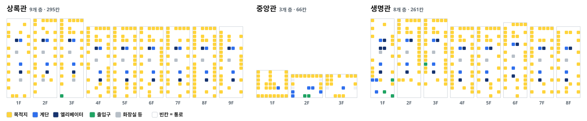

# 200동 실내 길찾기

서울대학교 농업생명과학대학 200동(상록관·중앙관·생명관)의 실내 길찾기 프로그램입니다.
농생대 정류장에서 내린 뒤 어느 출입구로 들어가 강의실 앞까지 어떻게 가면 되는지 안내합니다.

- 앱: https://jklee040515.github.io/cals200/
- 창의탐구 「건물 입구에서 강의실까지: SNU Campus 실내 길찾기 모델 제작」 (산림과학부 이진규)

## 데이터셋

200동 실내 길찾기에 쓰는 자료 세 파일입니다. 모두 JSON(UTF-8)이고 이 저장소에 그대로 있습니다(기준일 2026-11-12).



*building.json의 칸 622개를 층마다 그대로 칠한 그림(`python analyze.py`가 만듦). 노랑 = 목적지, 파랑 = 계단, 남색 = 엘리베이터, 초록 = 출입구, 회색 = 화장실 등, 빈칸 = 통로.*

| 파일 | 담긴 것 | 개수 | 크기 |
|---|---|---|---|
| `building.json` | 층별 칸 지도: 층별 안내도를 칸 격자로 옮긴 것 | 칸 622개(안내도 563 · 현장 기록 59), 3개 동 20개 층 | 35 KB |
| `site.json` | 정류장, 출입구 3곳, 정류장 → 출입구 실외 길 | 출입구 3곳 · 실외 길 3개 | 2 KB |
| `routes.json` | `make_routes.py`가 계산한 경로 | 506곳 × 출입구 3 × 2조건 = 경로 3,036개 | 1.1 MB |

### building.json

- 한 줄 = 칸 하나: `[구역, 층, 열, 행, 종류, 이름, 안내도]`
  예: `["green", 6, 2, 4, "room", "6208 환경재료과학 전공사무실·산림과학부행정실", 1]`
- 구역: `green` 상록관(9개 층, 6열×22행) · `main` 중앙관(3개 층, 8열×7행) · `bio` 생명관(8개 층, 6열×22행). 열은 남 → 북, 행은 서 → 동(도로 쪽).
- 종류: `room` 목적지 510칸 · `stairs` 계단 44 · `elevator` 엘리베이터 36 · `other` 화장실 등 20 · `door` 출입구 7 · `hall` 통로 5. 적지 않은 빈칸은 통로입니다.
- 안내도: `1` = 층별 안내도 사진에서 옮김(563칸), `0` = 현장에서 기록(59칸).
- 계단 이름 `to 3층` = 3층으로 이어지는 계단. 이름에 '화물'이 든 엘리베이터는 경로에서 뺍니다.
- 여러 칸에 같은 이름이 적힌 공간(예: 학습공간)은 목적지 한 곳으로 셉니다. 그래서 목적지 칸 510개 = 목적지 489곳입니다.

### site.json

- `stop`: 농생대 정류장(정류소 번호 21272, 버스 5511 · 5513 · 5516)과 위치
- `entrances`: 출입구 3곳. `id`, `floor`, `name`, `desc`(위치 설명), `cell`(격자 칸), `outdoor.pts`(정류장 → 출입구 실외 길, 꺾은선)
- 좌표는 앱 3D 모형의 좌표입니다(+x = 북쪽, +z = 동쪽). 실외 길은 캠퍼스 지도 그림을 옮긴 추정값이고, 1층 출입구 길은 그림에 없어 동쪽 보도로 추정했습니다(`outdoor.drawn` = false).

### routes.json

- `{asof, made_by, floor_cost, places: [{id, cells, all, lift}]}`. 경로를 만든 곳 506곳 = 목적지 489 + 화장실 등 17.
- `all` = 계단·엘리베이터 모두, `lift` = 엘리베이터만. 각 목록은 출입구 3곳의 경로를 총 거리 순으로 담아 맨 앞이 추천입니다.
- 경로 = `{e, total, out, walk, floors, lifts, path}`: 출입구, 총 거리(= out + walk + floors × 4, 단위 칸), 실외 거리, 실내 걷기 칸, 오르내린 층, 엘리베이터로 오르내린 층, 지나는 칸(`구역:층:열:행`을 띄어 씀).
- 예: 6208의 추천 경로 `{"e": "e3", "total": 41, "out": 6, "walk": 23, "floors": 3, "lifts": 3, …}` → 6 + 23 + 3 × 4 = 41칸, 3층 출입구(2층 출입구 54칸, 1층 출입구 81칸).

## 프로그램 구성

목적지 하나(예: 6208)가 다섯 부분을 차례로 지나며 안내가 됩니다.

```
① 자료와 형식        ② 계산              ③ 공개 라이브러리        ① 결과 형식      ④ 문장 규칙     ⑤ 화면
building.json  ─┐
                ├─▶  make_routes.py  ─▶  NetworkX 다익스트라  ─▶  routes.json  ─▶  guide.js  ─▶  앱 (3D 지도·평면도·단계 안내)
site.json      ─┘    analyze.py      ─▶  pandas 집계          ─▶  recommendations.csv · 포스터 결과
                     make_qr.py      ─▶  segno                ─▶  qr.png · 포스터 QR
```

| 부분 | 파일 | 하는 일 |
|---|---|---|
| **① 자료와 형식** (JSON) | `building.json` | 칸 622개. 한 줄 = `[구역, 층, 열, 행, 종류, 이름, 안내도 기준 여부]` |
| | `site.json` | 정류장, 출입구 3곳(층·칸·설명), 정류장 → 출입구 실외 길 |
| | `routes.json` | ②가 만든 결과. 506곳(목적지 489 · 화장실 등 17)마다 출입구 3곳 × 두 조건(계단 포함 / 엘리베이터만)의 거리와 지나는 칸 |
| **② 계산** (Python) | `make_routes.py` | 칸 격자 → 그래프 → 출입구 3곳에서 모든 목적지까지 최단 경로 → `routes.json`, 경로 점검 |
| | `analyze.py` | 추천 출입구 집계(구역 × 출입구 표, 3층 출입구 비율, 총 거리 중앙값·범위·평균)와 데이터셋 그림 `dataset.svg` |
| **③ 공개 라이브러리** | `requirements.txt` | NetworkX(그래프·최단 경로), pandas(집계), segno(QR, `make_qr.py`) |
| **④ 문장 규칙** (JavaScript) | `guide.js` | 경로를 단계 안내 문장으로. 문장 틀은 맨 위 `SAY` 한곳에 모음 |
| **⑤ 화면** (JavaScript·HTML·CSS) | `index.html`, `style.css`, `app.js` | 화면 뼈대, 디자인, 화면 전환(홈 → 경로 → 단계 안내 → 도착) |
| | `map3d.js`, `plan.js` | 3D 지도, 층 평면도 (외부 라이브러리 없이 캔버스에 직접 그림) |
| | `data.js`, `grid.js`, `search.js`, `state.js`, `dom.js` | 자료 읽기, 격자 모양, 검색, 현재 상태, 화면 도구 |
| | `sw.js`, `manifest.webmanifest`, `icon-*.png` | 홈 화면 설치, 오프라인 사용 |

GitHub 웹 업로드로 한 번에 올릴 수 있도록 모든 파일을 한 폴더에 둡니다. 각 파일 맨 위 주석에 `[2 계산]`처럼 어느 부분인지 적었습니다.

## ① 자료와 형식

파일마다 담긴 것, 형식, 개수는 맨 위 [데이터셋](#데이터셋)에 있습니다. `building.json` 맨 위에도 형식 설명이 있습니다.

## ② 계산: 거리 규칙

```
총 거리 = 실외(정류장 → 출입구) + 실내 걷기 칸 + 오르내린 층 × 4칸
```

- 칸 = 점, 걸어갈 수 있는 이웃 칸 = 선. 옆 칸으로 한 칸 = 1, 한 층 오르내리기 = 4.
- 총 거리가 가장 짧은 출입구를 추천합니다. 같으면 층 이동이 적은 쪽입니다.
- 목적지 칸은 들어가는 선만 있어 도착할 때만 들어갑니다. 경로가 다른 방을 지나가지 않습니다.
- 계단·엘리베이터 칸은 '타는 곳'과 '내리는 곳' 두 점으로 나눠, 같은 층에서 옆으로 지나가지 못하고 오르내릴 때만 지나갑니다.
- 계단 칸은 표지가 가리키는 층으로 이어집니다(이름 `to 3층`). 층마다 칸 위치가 한 칸쯤 어긋나도 주변 3×3 칸에서 찾습니다(중앙관 원형 계단).
- 같은 층에 같은 이름으로 적힌 칸(예: 중앙관 1층 학습공간)은 한 곳이며, 가장 가까운 칸에 닿으면 도착입니다.
- 화물 엘리베이터는 쓰지 않습니다.
- 한 층 = 4칸인 까닭: 층 비용을 1~2칸으로 두면 "내려갔다 다시 올라오는" 경로가 생깁니다(1칸 37건, 2칸 5건, 3칸부터 0건, `python make_routes.py --floor-check`).

`make_routes.py`는 경로를 만든 뒤 스스로 점검합니다: 경로 3,036개 가운데 방을 지나감 0, 계단·엘리베이터를 옆으로 지나감 0, 못 가는 곳 0.

## ③ 공개 라이브러리

| 라이브러리 | 쓴 곳 | 쓴 기능 |
|---|---|---|
| NetworkX | `make_routes.py` | `nx.DiGraph()` 방향 그래프, `add_edge(…, weight=…)` 선과 거리, `nx.single_source_dijkstra()` 한 출입구에서 모든 칸까지 최단 거리와 경로 |
| pandas | `analyze.py` | `DataFrame` 표, `pd.crosstab()` 구역 × 추천 출입구 표, `median()`·`mean()` 기술통계, `to_csv()` |
| segno | `make_qr.py` | `segno.make()` 앱 주소 QR(오류 정정 Q) |

앱(JavaScript)은 외부 라이브러리를 쓰지 않습니다. 3D 지도와 평면도는 브라우저 캔버스에 직접 그립니다.

## ④ 문장 규칙

`guide.js`는 경로를 '같은 층 걷기'와 '층 이동' 구간으로 자른 뒤, 구간마다 문장 틀에 이름을 끼워 넣습니다.

| 단계 | 문장 틀 | 예 |
|---|---|---|
| 실외 | [정류장]에서 내려 [출입구]로 가요 | 농생대 정류장에서 내려 3층 출입구로 가요 |
| 층 이동 | 엘리베이터를 타고 [층]에서 내려요 / [계단]으로 [층]까지 올라가요 | 엘리베이터를 타고 6층에서 내려요 |
| 걷기 | [어디서] + [어디까지] + 걸어가요 | 엘리베이터에서 나와 ‘6208’ 앞까지 걸어가요 |
| 작은 글씨 | [걷는 방향] · [도착 위치] | 건물 안쪽(서쪽)으로 · 정면에 있어요 |

- 어디서: 출입구로 들어와 / 엘리베이터·계단에서 나와 / [구역]으로 건너가
- 어디까지: ‘목적지’ 앞까지 / 엘리베이터·계단까지 / [구역] 쪽으로
- 걷는 방향: 남북(상록관 쪽·생명관 쪽)과 동서(도로 쪽·건물 안쪽) 가운데 더 많이 움직인 쪽
- 도착 위치: 마지막 세 칸이 꺾이는 방향(왼쪽·오른쪽·정면)
- 화면에는 '몇 칸' 같은 숫자 대신 방향과 이동 수단을 말합니다(칸은 실제 거리가 아니므로).

## ⑤ 화면

- 홈: 방 번호·이름 검색(‘상록관 3층’처럼 좁히기), 최근 찾은 곳, 층별로 찾기
- 경로: 추천 경로 한 줄(정류장 › 3층 출입구 › 엘리베이터 3→6층 › 6208), 출입구 3곳 비교, '계단 없이' 선택
- 단계 안내: 실외 단계는 3D 지도와 카카오맵 연결, 걷기 단계는 층 평면도와 경로 선, 여러 칸짜리 공간은 한 덩어리로
- 도착: 지나온 경로 한 줄
- 휴대전화 홈 화면 설치·오프라인 사용, 주소 끝 `#r-green-6-2-4`로 목적지 바로 열기, QR

## 실행

```bash
pip install -r requirements.txt   # 한 번만 (networkx, pandas, segno)
python make_routes.py             # building.json·site.json → routes.json, 점검
python analyze.py                 # 집계표, recommendations.csv, dataset.svg
python make_qr.py                 # qr.png, qr.svg
```

- 자료(`building.json`·`site.json`)를 고치면 `make_routes.py`를 다시 실행하고 `routes.json`을 함께 올립니다.
- 내 컴퓨터에서 앱 열기: 이 폴더에서 `python -m http.server 8000` → http://localhost:8000 (`index.html`을 더블클릭하면 브라우저가 자료 읽기를 막음).
- GitHub Pages에 올리기: 저장소에서 **Add file → Upload files** → 이 폴더의 파일을 끌어다 놓고 **Commit changes**. 파일을 바꿔 올릴 때마다 `sw.js`의 `CACHE` 끝 숫자를 올립니다.

## 결과 (`analyze.py`, 자료 기준일 2026-11-12)

| | 계단·엘리베이터 모두 | 엘리베이터만 |
|---|---|---|
| 목적지 | 489곳 모두 경로 있음 | 같음 |
| 3층 출입구 추천 | 423/489곳 (87%) | 434/489곳 (89%) |
| 총 거리(칸) | 중앙값 37, 범위 9–59, 평균 36.5 | 중앙값 37, 범위 9–61, 평균 37.2 |

구역별(계단·엘리베이터 모두): 상록관 246곳 중 3층 243·2층 3 / 중앙관 32곳 중 2층 18·3층 14 / 생명관 211곳 중 3층 166·2층 38·1층 7.
여러 칸짜리 공간(학습공간, 휴식공간, 3108)은 한 곳으로 셉니다.

## 한계

- 거리 단위 '칸'은 안내도 격자 한 칸이며 실제 미터가 아닙니다. 그래서 앱 화면에는 숫자 대신 경로를 보여 줍니다.
- 실외 길은 지도 그림을 모형에 옮긴 추정값입니다. 1층 출입구 길은 그림에 없어 동쪽 보도로 추정했습니다.
- 칸 자료 563개는 층별 안내도 기준이며 현장 확인 전입니다.
- 시간이 아니라 거리 기준의 최소 경로입니다.
